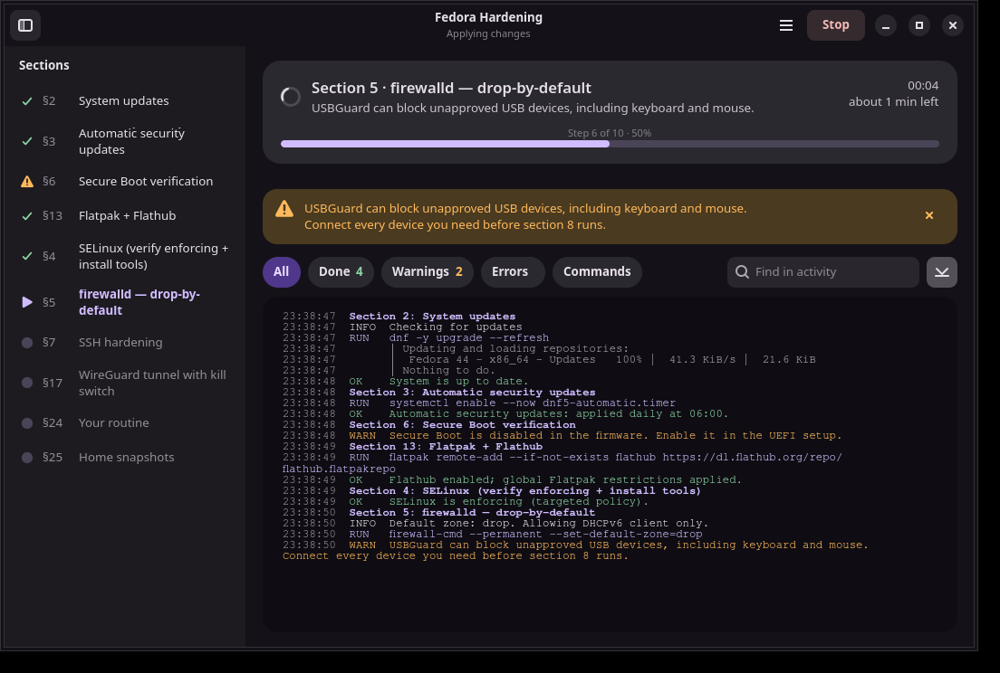
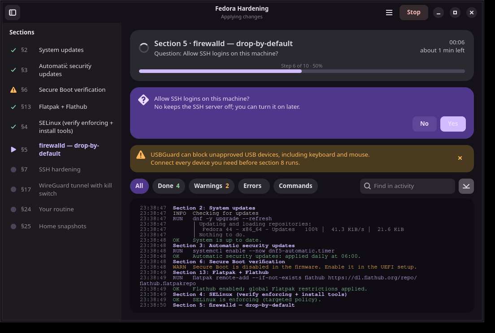
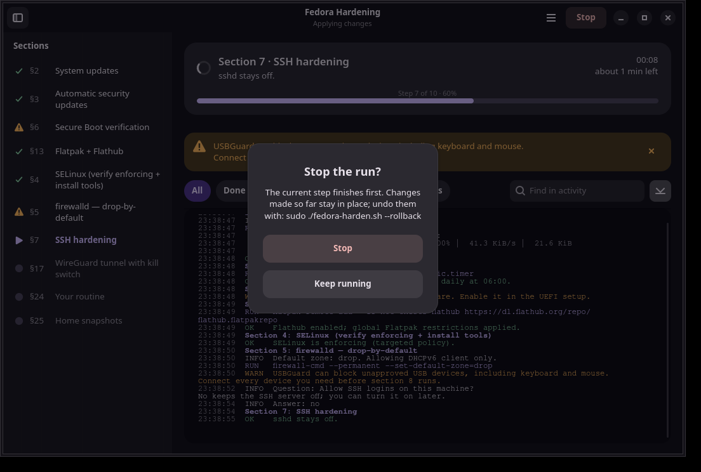
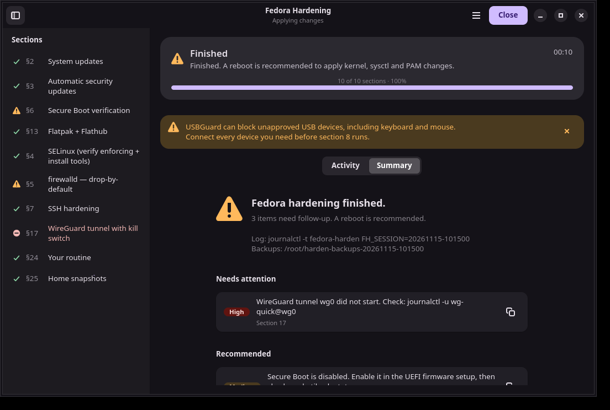

# fedora-hardening

> **A comprehensive, idempotent security hardening script for Fedora and all Atomic Desktop variants.**  
> Aligned with [privacyguides.org](https://www.privacyguides.org) and [inteltechniques.com](https://inteltechniques.com) recommendations.

---

## Overview

`fedora-harden.sh` is a single-file Bash script that applies 23 hardening sections to a Fedora system in one pass. It auto-detects your release variant (Workstation, Silverblue, Kinoite, Bazzite, etc.), package manager (`dnf` vs. `rpm-ostree`), and desktop environment, then applies the appropriate hardening steps automatically.

Every change is journaled for full rollback support. The script is safe to run multiple times — all operations are idempotent.

This is a personal hardening script that has grown a substantial feature set and a real CI pipeline, not a vendor-supported product — it runs as root and touches SSH, PAM, the kernel, and your firewall, so read `--dry-run` output before trusting it on a machine you can't easily reinstall.

---

## Features

- **23 hardening sections** covering the full security surface of a Fedora desktop or server
- **Dual package-manager support** — mutable (`dnf`) and immutable (`rpm-ostree`) systems handled transparently
- **Full Atomic Desktop support** — Silverblue, Kinoite, Onyx, Sericea, Lazurite, Vauxite, Bazzite, Aurora, CoreOS, and more
- **Per-desktop-environment hardening** — KDE Plasma, GNOME, Budgie, Cinnamon, MATE, XFCE, LXQt, Sway, Hyprland, i3
- **Firefox Flatpak hardening** — arkenfox user.js + uBlock Origin, LocalCDN, Multi-Account Containers
- **Containerized-mindset setup** — rootless Podman + Toolbox with image policy hardening, no-new-privileges, seccomp, and unqualified-registry blocking
- **Hardware security key support** — YubiKey/FIDO2/PIV/pam-u2f packages + USBGuard integration
- **VPN detection** — WireGuard, Mullvad, ProtonVPN, IVPN detection with recommendations when absent
- **Full rollback** — per-session change journal; `--rollback` or `--rollback all` to undo any or every run
- **Logs in the system journal** — `journalctl -t fedora-harden`; failed services are reported with their own log lines
- **Reports and follow-ups** — `--report` writes one HTML page per session; `--resume` brings back open follow-ups
- **Dry-run mode** — preview all changes without touching the system
- **GUI** — `--gui` runs the whole session in one window: sections, progress, live activity log, questions and summary, in a Material Design dark theme (see [GUI](#gui))
- **4-layer caching** — memoized command checks, package status, user home dirs, and rpm-ostree pending layers

---

## Sections at a Glance

| # | Section | Notes |
|---|---------|-------|
| 2 | System updates | `dnf upgrade` + fwupd firmware/microcode + optional HW security key |
| 3 | Automatic updates | `dnf5-plugin-automatic` (security-only) or `rpm-ostreed` |
| 4 | SELinux | Enforcing; a disabled system goes permissive + full relabel first (safe path) |
| 5 | firewalld | Drop-default zone policy (OpenSnitch suggested for outbound control) |
| 6 | Secure Boot | Verification (GRUB password is manual — printed as an action item) |
| 7 | SSH hardening | Key-based auth, hardened ciphers via `sshd_config.d/10-hardening.conf` (takes precedence over Fedora's defaults); never restarts sshd on an invalid config |
| 8 | USBGuard | Interactive — plug in devices before this section runs |
| 9 | Password & PAM | pwquality (min length 14, 3 classes), faillock (5 tries, 15 min), account aging |
| 10 | Kernel sysctl | Network, VM, filesystem, IPv6 privacy extensions (RFC 4941) |
| 11 | auditd | Identity, privilege escalation, module, time/network/mount/delete syscalls |
| 12 | File integrity | rkhunter + AIDE; image-based: image signature status + weekly report of `/etc` changes |
| 13 | Flatpak / Flathub | Blocks Flatpak apps from the host filesystem; mat2 (image-based: Metadata Cleaner Flatpak); Firejail opt-in only |
| 14 | DNS over TLS | systemd-resolved with Quad9 + Cloudflare (installed if missing; warns if DNS bypasses it) |
| 14b | MAC randomization | NetworkManager network-layer privacy |
| 15 | Desktop settings | Screen lock, recent docs, Bluetooth, location, mic — per DE, verified after applying |
| 16 | Firefox | Flatpak + pinned arkenfox + GPC/DNT + DNS-over-HTTPS (ECH) + extensions + VPN detection |
| 17 | WireGuard | With `--wireguard-config FILE`: the tunnel, a kill switch and DNS through the tunnel; nothing otherwise |
| 18 | Fail2Ban | Intrusion detection + auto-ban |
| 19 | Service cleanup | Disable avahi, cups, bluetooth, modemmanager |
| 20 | File permissions | shadow, /tmp, compilers, umask 077, core dumps, hostname privacy, unencrypted-swap check |
| 21 | ClamAV | clamd + freshclam + on-access scanning of /home; image-based: weekly scan in a locked-down container |
| 22 | OpenSCAP | Compliance scan (image-based: from a throwaway container, nothing layered) |
| 24 | Your routine | Timers for the upkeep this machine's use cases need, a weekly drift check and summary, desktop notifications |
| 25 | Home snapshots | Btrfs snapshots (Snapper on Bazzite) or incremental copies of home, as often as the machine is used |
| 23 | Container security | Rootless Podman, image policy, seccomp, registry hardening; toolbox or distrobox for tools |

**Sections not automated by design:** LUKS (Anaconda install-time), GRUB password (interactive key derivation), WireGuard tunnel config (requires peer keys).

---

## Requirements

- **Fedora 44+** (or a compatible Atomic/Universal Blue variant) — every change is tested on Fedora 44 and 45 (see [Testing](#testing))
- `bash` 5.x
- `sudo` / root access
- Internet connection (for package installs and firmware updates)

---

## Quick Start

```bash
# Clone the repo
git clone https://github.com/nixbys/fedora-hardening.git
cd fedora-hardening

# Preview what would change (no modifications made)
sudo ./fedora-harden.sh --dry-run

# Run all sections interactively
sudo ./fedora-harden.sh

# Target a specific user for SSH/home-dir hardening
sudo ./fedora-harden.sh --user yourusername

# Run only specific sections
sudo ./fedora-harden.sh --only 5,7,10

# Skip sections you don't want
sudo ./fedora-harden.sh --skip 8,21
```

> **Non-interactive runs (`--yes`)** accept every recommendation, with one safety
> exception: SSH hardening is skipped (and reported as a HIGH follow-up item) when
> the target user has no public key in `~/.ssh/authorized_keys`, because disabling
> password logins would lock you out.

---

## All Options

```
sudo ./fedora-harden.sh [options]

  -u, --user <name>       Target username for SSH/chage/home-dir hardening
  -y, --yes               Assume "yes" to all prompts (non-interactive)
  -n, --dry-run           Print what would run; make no changes
      --gui               Windowed frontend: progress window, dialogs and summary
      --report [file]     Write an HTML report of the last session and exit
      --resume            Review the last session's open follow-ups and exit
      --wireguard-config <file>  Install this WireGuard config with a kill switch (section 17)
      --profile <list>    Use cases for section 24: everyday,gaming,creative,dev,laptop
      --backup-target <dir>  Second drive for home copies on systems without Btrfs (section 25)
      --skip <list>       Comma-separated sections to skip  (e.g. 7,8,17)
      --only <list>       Comma-separated sections to run exclusively
      --list              List all section numbers & names and exit
      --list-sessions     List all past hardening sessions with their status
      --rollback [id|all] Roll back changes from the last session (or session <id>)
                          Use 'all' for a full-reset rollback of every session
  -h, --help              Show this help and exit
```

---

## GUI

```bash
sudo ./fedora-harden.sh --gui          # the whole run in one window
```

Everything happens in one window:

- **Sections** (left): every section this run will go through, in execution order,
  with its status: running, done, done with warnings or errors, or skipped when it
  does not apply to this system. F9 shows or hides the list; narrow windows fold it
  away.
- **Status card**: the section running now and its latest step, a progress bar,
  the elapsed time and an estimate of the time left.
- **Questions** appear inside the window with Yes/No buttons or a text field. Enter
  picks the default answer; nothing pops up in a separate dialog.
- **Notices** that need reading (USBGuard, the manual GRUB password, VPN choices)
  stay at the top until you dismiss them.
- **Activity**: a live log of every message, command and command output, with
  filters (done, warnings, errors, commands), search, follow mode, and Copy activity
  log / Copy problems only in the menu.
- **Summary**: at the end, the outcome, the log and backup locations, and the
  follow-up items grouped by priority, each with a copy button.

**Stop** (or closing the window, or Ctrl+W) asks first, then stops after the
current step with exit code 130; changes made so far can be undone with
`--rollback`. The window stays open after the run so you can read the results.

The window is a GTK4/libadwaita app embedded in the script. Those libraries and their
Python bindings come with Fedora Workstation and every Atomic desktop (Silverblue,
Kinoite, Bazzite, Bluefin), so nothing is layered for the GUI; on other package-based
systems `--gui` installs `python3-gobject`, `gtk4` and `libadwaita`. Its Material
Design 3 dark theme is private to the window and does not change your desktop. It
works under `sudo` (Fedora keeps `DISPLAY`/`XAUTHORITY`). Without a usable display,
the run stays in the terminal.

| Running | Question |
|---|---|
|  |  |
| **Stopping** | **Summary** |
|  |  |

Screenshots are generated by `tests/gui-screenshots.sh`, which plays a sample run
into the window embedded in `fedora-harden.sh` (Fedora 44, virtual display, so the
rounded window corners a compositor draws on a real desktop are not shown).

---

## Platform Support

| Variant | Package Manager | Desktop |
|---------|----------------|---------|
| Fedora Workstation | `dnf` | GNOME |
| Fedora Server | `dnf` | — |
| Fedora Spins (XFCE, LXQt, Cinnamon, MATE, Budgie) | `dnf` | various |
| Fedora Silverblue | `rpm-ostree` | GNOME |
| Fedora Kinoite | `rpm-ostree` | KDE Plasma |
| Fedora Onyx | `rpm-ostree` | GNOME Atomic |
| Fedora Sericea | `rpm-ostree` | Sway Atomic |
| Fedora Lazurite | `rpm-ostree` | LXQt Atomic |
| Fedora Vauxite | `rpm-ostree` | XFCE Atomic |
| Fedora IoT / Cloud / CoreOS | `rpm-ostree` | headless |
| Bazzite | `rpm-ostree` | KDE or GNOME |
| Aurora / Universal Blue | `rpm-ostree` | KDE |

Auto-detection reads `/etc/os-release` + `/run/ostree-booted`. Desktop detection uses `$XDG_CURRENT_DESKTOP` + installed tooling.

---

## Image-based systems

On Silverblue, Kinoite, Bazzite, Aurora and the other Atomic variants, every
layered package has to be re-applied to each new image, and it widens the image
everyone else gets from the vendor. So the script keeps tools out of the image and
puts each one where it belongs:

| What | Package-based Fedora | Image-based Fedora |
|------|----------------------|--------------------|
| YubiKey manager (section 2) | `yubikey-manager`, `yubico-piv-tool` | Yubico Authenticator Flatpak (`com.yubico.yubioath`); only drivers and `pam-u2f` are layered |
| SELinux tools `seinfo`, `sesearch` (4) | `setools-console` | in the tools box |
| File integrity (12) | rkhunter + AIDE | image signature check + weekly report of `/etc` changes (`journalctl -t fedora-harden-etc`) |
| Metadata removal (13) | `mat2` | Metadata Cleaner Flatpak |
| ClamAV (21) | clamd, freshclam, on-access scanning | weekly `fedora-harden-clamscan` container: read-only view of `/home`, no network, signatures in the image |
| OpenSCAP (22) | `openscap-scanner` | throwaway Fedora container scanning the host read-only (`oscap-chroot`) |
| buildah, skopeo, podman-compose (23) | packages | in the tools box |

The **tools box** (`fedora-harden-tools`) uses the platform's own tool: distrobox
on Universal Blue (which ships it instead of toolbox), toolbox elsewhere. With
distrobox, the script writes a manifest to `~/.config/distrobox/fedora-harden-tools.ini`:

```bash
distrobox assemble create --file ~/.config/distrobox/fedora-harden-tools.ini
# Universal Blue:
ujust distrobox-assemble CONTAINER=fedora-harden-tools FILE=$HOME/.config/distrobox/fedora-harden-tools.ini
```

> ⚠️ **Toolbox and distrobox are not a security boundary.** Their containers share
> your home directory, see the host's filesystem at `/run/host` and run privileged
> without SELinux separation. Use them to keep the host clean, not to run untrusted
> software — for that, use a Flatpak with tight permissions or a locked-down
> `podman run --read-only --cap-drop all --network none ...`.

---

## Rollback

Every file the script modifies is backed up before the change, and every file it creates is journaled, so a rollback restores modified files **and removes created ones** (drop-ins, rules, cron jobs). A session journal is written to `/root/harden-backups-<timestamp>/`.

```bash
# Undo the most recent run
sudo ./fedora-harden.sh --rollback

# Undo a specific past session
sudo ./fedora-harden.sh --list-sessions
sudo ./fedora-harden.sh --rollback 20260601-143022

# Full-reset: reverse every session from the very first run
sudo ./fedora-harden.sh --rollback all
```

---

## Your routine (Section 24)

Hardening is not a one-time job: updates, cleanup, disk health, and noticing when a
protection was undone. Section 24 sets that up to match how the machine is used. It
detects the likely use cases (Steam or Bazzite: gaming; Blender, Kdenlive, Resolve:
creative; IDEs or container storage: development; a battery: laptop), asks once
(or takes `--profile`), saves the answer in `/etc/fedora-harden/profile`, and adds only
the timers those use cases need:

| Timer | What it does | For |
|-------|--------------|-----|
| `fedora-harden-cleanup` (monthly) | unused Flatpak runtimes, dangling Podman images, old OSTree data | everyone |
| `fedora-harden-diskspace` (daily) | notifies below 10% free | everyone |
| `fedora-harden-scrub` (monthly) | Btrfs scrub: finds silent corruption | Btrfs systems |
| `fedora-harden-drift` (weekly) | notifies if a file the script manages changed or a service it started stopped | everyone |
| `fedora-harden-summary` (Mondays) | what was done, what needs you, open follow-ups; a relevance review every 90 days | everyone |
| `fedora-harden-boxes` (weekly) | upgrades toolbox/distrobox containers (Universal Blue's uupd already does) | creative, dev |
| `fedora-harden-devclean` (weekly) | removes container build cache older than 30 days | dev |
| `fedora-harden-flatpak-perms` (weekly, asked) | tells you when an app update widened its permissions | creative |

Plus a 1 GB journal cap, `smartd` disk-health warnings, an optional 80% battery
charge limit on laptops, and on image-based systems a list of layered packages that
have a better home. Heavy jobs wait for mains power and for a game to end. A desktop
notification appears only when something needs you; the weekly summary is in
`/var/lib/fedora-harden/summary-<date>.txt`, and every run is in
`journalctl -t fedora-harden-routine`. Every 90 days the summary asks for a review: if
the machine now looks different from its saved use cases, or an automation has had
no effect, it says so. Re-run `--only 24` to change the routine; `--rollback` removes it.

## Home snapshots (Section 25)

Gets back a file you deleted or overwrote, on every supported system, with what the
system already ships:

| System | How |
|--------|-----|
| Btrfs with Snapper (Bazzite) | Snapper's own `home` config |
| Btrfs without Snapper (Silverblue, Kinoite, Bluefin, Aurora, Workstation) | read-only Btrfs snapshots in `/home/.snapshots` |
| Btrfs where home is a plain folder (bootc installs) | home becomes its own subvolume at the next boot, before anyone logs in; snapshots start then |
| No Btrfs (e.g. Fedora Server on XFS) | hard-link incremental copies with `rsync`: to a second drive when configured (`--backup-target DIR`, `/backup`, `/mnt/backup`), otherwise on the same disk |

- **As often as the machine is used:** 6+ active hours a day → hourly, 1–6 → every
  6 hours, less → daily; nothing is taken when nothing changed. Kept: 24 recent,
  7 daily, 4 weekly. Snapshots never push the disk below 15% free.
- **Index and change notes:** the first run indexes the home folder (folders of
  5 GB or more); each snapshot keeps a note of what changed; the weekly index notes
  what grew and flags new large folders. Large replaceable folders (container
  storage, caches, game libraries) are left out of snapshots only if you say yes,
  folder by folder.
- **Not a backup:** snapshots live on the same disk. The follow-ups rank ways to
  keep a copy elsewhere for this machine (an external drive with Pika Backup, a
  network share, or cloud storage with Déjà Dup); the choice is yours.
- **Restore** by copying from `/home/.snapshots/<date>/<user>/…` (or Snapper's
  tools on Bazzite). `--rollback` removes the timers but never deletes snapshots.

## WireGuard with a kill switch (Section 17)

Download a WireGuard config from your VPN provider (a full tunnel:
`AllowedIPs = 0.0.0.0/0, ::/0`) and pass it to section 17:

```bash
sudo ./fedora-harden.sh --only 17 --wireguard-config ~/Downloads/provider.conf
```

The script checks the config (complete, one peer, full tunnel; a hostname endpoint
is pinned to its current address), installs it as `/etc/wireguard/wg0.conf`
(mode 600) and starts `wg-quick@wg0` at boot. Two protections come with it:

- **Kill switch** — firewalld policies let this machine send traffic only into the
  tunnel or to the tunnel's own endpoint. If the tunnel drops, nothing leaks out
  around it (the local network is blocked too; the follow-up says how to allow it).
- **DNS through the tunnel** — systemd-resolved sends every lookup to the tunnel's
  DNS server while it is up.

`--rollback` stops the tunnel and removes the config and the kill switch. Without a
config file, section 17 does nothing.

## Hardware Security Keys

During **Section 2**, the script will ask if you use a hardware security key (YubiKey, FIDO2, PIV, etc.). If yes, it installs `pcsc-lite`, `opensc`, `libfido2`, `yubico-piv-tool`, and `yubikey-manager`, and optionally sets up `pam-u2f`. On image-based systems it layers only the drivers (and `pam-u2f`) and installs the Yubico Authenticator Flatpak instead of the management tools.

> ⚠️ **Important:** If you use a hardware key, plug it in **before Section 8 (USBGuard) runs** so it is automatically added to the allowlist. If you miss it, run:
> ```bash
> sudo usbguard generate-policy >> /etc/usbguard/rules.conf
> ```

---

## Container Security (Section 23)

Section 23 sets up a **containerized-mindset** environment using rootless Podman and toolbox (distrobox on Universal Blue):

- Configures `~/.config/containers/containers.conf` with `no-new-privileges`, hardened seccomp, and minimal capabilities
- Writes `/etc/containers/policy.json` to reject images from registries other than Fedora, CentOS, Red Hat, quay.io and docker.io (confirm-gated)
- Blocks unqualified image searches via `/etc/containers/registries.conf.d/99-hardening.conf`
- Configures `subuid`/`subgid` for rootless container operation
- Optionally installs `buildah`, `skopeo`, and `podman-compose` — on image-based systems they go in the tools box instead (see [Image-based systems](#image-based-systems))

Toolbox and distrobox keep development tools off the host; they do not isolate them (see the warning above).

---

## After Running

Check that the hardening is really in effect. This only reads state and changes nothing:

```bash
sudo ./tests/verify-host.sh            # every check, with PASS / FAIL / SKIP
sudo ./tests/verify-host.sh --only SSH # one area: AUTO SEL FW SSH PAM SYS AUD DNS CLAM INT DESK FLAT PERM ROLL
```

The script prints a prioritized list of **follow-ups** at the end (HIGH / MEDIUM / LOW), each with the command to run. If a service it enabled or restarted failed, the follow-up quotes that service's own log lines. Everything the run did is in the system journal:

```bash
journalctl -t fedora-harden                         # every run
journalctl -t fedora-harden FH_SESSION=20261110-213440 -p warning   # one run, problems only
sudo ./fedora-harden.sh --resume                    # the last run's open follow-ups, fixes offered again
sudo ./fedora-harden.sh --report                    # one HTML page: changes, follow-ups, warnings, live checks
```

---

## Testing

All tests run on **Fedora 44 and 45** in throwaway rootless podman containers — the
host is never modified:

```bash
./tests/run-suite.sh                  # everything
./tests/run-suite.sh --tier static    # shellcheck, shfmt, yamllint, hadolint, ruff
./tests/run-suite.sh --tier quick     # CLI, dry-run makes no changes, desktop settings
./tests/run-suite.sh --tier full      # real run under systemd, idempotency, rollback
./tests/run-suite.sh --tier gui       # --gui on a virtual display, theme, Cancel
./tests/run-suite.sh --tier atomic    # real Silverblue + Universal Blue images (systemd containers)
./tests/run-suite.sh --tier vm        # the same images installed and booted in a VM (KVM)
./tests/run-suite.sh --tier fault     # fault injection: no network, full disks, kills, ...
./tests/run-suite.sh --fedora 45      # the same on Fedora 45 (default: 44)
```

Image-based behaviour is tested on the real images, not simulated: the atomic tier
runs the images' own rpm-ostree, Flatpak, Podman quadlets and distrobox, and the vm
tier installs each image with `bootc` and boots it, so the image-signature check and
the `/etc` change report run against a real OSTree system.

The full tier checks the hardening is really in effect (e.g. the effective sshd
configuration via `sshd -T`, the password policy files), that a second run
changes nothing, and that `--rollback all` restores the system. See
[TESTING.md](TESTING.md); setup is `./setup-dev.sh` (Fedora RPM toolchain).

---

## Repository Layout

```
fedora-harden.sh               # the tool: 23 hardening sections
tests/run-suite.sh             # test suite: static, quick, full and gui tiers (see TESTING.md)
tests/*.sh, tests/*.py         # in-container checks (desktop settings, image-based simulation, GUI, MCP smoke test)
tests/fixtures/                # sample tool output used by the tests (OpenSCAP results)
test-in-podman.sh              # ad-hoc runs in a throwaway podman container
Dockerfile.test                # test images (FEDORA_VERSION 44/45): base, test-only, lint, gui
setup-dev.sh                   # contributor setup (Fedora RPM toolchain + git hooks)
tests/verify-host.sh           # read-only check of a hardened machine (see After Running)
mcp_server_fedora_harden.py    # optional, contributor-only: exposes lint/test workflows
                               # as MCP tools — not used by fedora-harden.sh at runtime
.pre-commit-config.yaml        # local lint/format/secret-scan hooks
.github/workflows/             # CI (Fedora 44 + 45 containers): tests, gitleaks, trivy,
                               # workflow-security (actionlint + zizmor)
SECURITY.md / THREAT_MODEL.md  # responsible-use policy and trust boundary
DEVELOPMENT.md                 # contributor setup, conventions, CI, keeping up with guidance
TESTING.md / QUICKSTART-TESTING.md  # how to exercise the script in Podman
```

If you're only here to harden a machine, `fedora-harden.sh` is the only file
you need — everything else is for people modifying the script itself.

---

## CI

| Check | Tool | Status |
|-------|------|--------|
| Shell syntax | `bash -n` | [](https://github.com/nixbys/fedora-hardening/actions/workflows/ci.yml) |
| Static analysis | ShellCheck 0.11.0 (`--enable=all`) | ↑ same |
| Formatting | shfmt v3.12.0 (style from `.editorconfig`) | ↑ same |
| Container tests | `tests/run-suite.sh` quick, full and gui tiers (Fedora 44 and 45, podman) | ↑ same |
| Secret scanning | gitleaks (full history, blocking) | ↑ same |
| Vulnerabilities | Trivy (results in the Security tab) | ↑ same |
| Workflow security | actionlint + zizmor | [](https://github.com/nixbys/fedora-hardening/actions/workflows/workflow-security.yml) |

See [SECURITY.md](SECURITY.md) for how to report a vulnerability and
[THREAT_MODEL.md](THREAT_MODEL.md) for the trust assumptions behind running
this script as root.

---

## Sources and staying current

Each recommendation cites its source in the script (`# Source:` comments). The
sources are listed in [`docs/references.json`](docs/references.json) with the
sections they inform and when they were last reviewed:

- Privacy Guides: Linux Overview, Desktop/PC, Linux Application Sandboxing, DNS
  Resolvers, Desktop Browsers
- IntelTechniques: 2026 OS Telemetry Guide, Extreme Privacy Linux commands
- arkenfox `user.js` (pinned release, checksum-verified)

The **Reference watch** workflow runs every Monday. It fetches each source,
compares its main content with the last review, checks for a newer arkenfox
release, and opens one tracking issue when something changed. After updating the
script, refresh the fingerprints:

```bash
python3 tests/check-references.py           # what changed since the last review
python3 tests/check-references.py --update  # after review: record the new state
```

---

## Changes

See [CHANGELOG.md](CHANGELOG.md) for what changed and why.

---

## References

- [Privacy Guides — Linux Overview](https://www.privacyguides.org/en/os/linux-overview/)
- [Privacy Guides — Linux Application Sandboxing](https://www.privacyguides.org/articles/2022/04/22/linux-application-sandboxing/)
- [IntelTechniques — 2026 OS Telemetry Guide](https://inteltechniques.com/2026.telemetry.html) (Extreme Privacy, 5th edition)
- [Fedora Quick Docs](https://docs.fedoraproject.org/en-US/quick-docs/) (SELinux, firewalld, Atomic desktops)
- [CIS Red Hat Enterprise Linux Benchmarks](https://www.cisecurity.org/benchmark/red_hat_linux)
- [arkenfox user.js](https://github.com/arkenfox/user.js)

The full, machine-checked list is [`docs/references.json`](docs/references.json).

---

## License

This project is provided as-is for personal use. Review every section before running on a production system. No warranty is expressed or implied.
