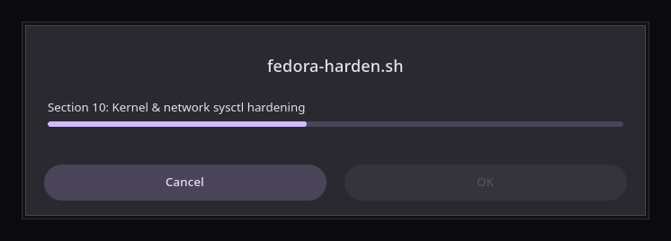
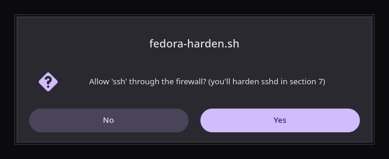
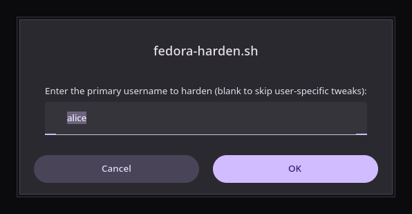
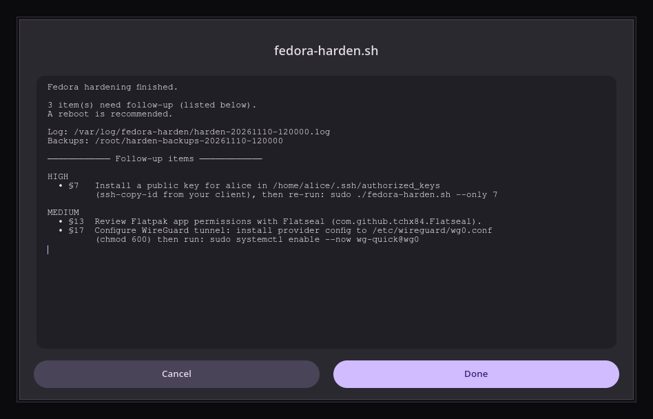

# fedora-hardening

> **A comprehensive, idempotent security hardening script for Fedora and all Atomic Desktop variants.**  
> Aligned with [privacyguides.org](https://www.privacyguides.org) and [inteltechniques.com](https://inteltechniques.com) recommendations.

---

## Overview

`fedora-harden.sh` is a single-file Bash script that applies 23 hardening sections to a Fedora system in one pass. It auto-detects your release variant (Workstation, Silverblue, Kinoite, Bazzite, etc.), package manager (`dnf` vs. `rpm-ostree`), and desktop environment, then applies the appropriate hardening steps automatically.

Every change is journaled for full rollback support. The script is safe to run multiple times — all operations are idempotent.

This is a personal hardening script that has grown a substantial feature set and a real CI pipeline, not a vendor-supported product — it runs as root and touches SSH, PAM, the kernel, and your firewall, so read `--dry-run` output before trusting it on a machine you can't easily reinstall.

---

## Features

- **23 hardening sections** covering the full security surface of a Fedora desktop or server
- **Dual package-manager support** — mutable (`dnf`) and immutable (`rpm-ostree`) systems handled transparently
- **Full Atomic Desktop support** — Silverblue, Kinoite, Onyx, Sericea, Lazurite, Vauxite, Bazzite, Aurora, CoreOS, and more
- **Per-desktop-environment hardening** — KDE Plasma, GNOME, Budgie, Cinnamon, MATE, XFCE, LXQt, Sway, Hyprland, i3
- **Firefox Flatpak hardening** — arkenfox user.js + uBlock Origin, LocalCDN, Multi-Account Containers
- **Containerized-mindset setup** — rootless Podman + Toolbox with image policy hardening, no-new-privileges, seccomp, and unqualified-registry blocking
- **Hardware security key support** — YubiKey/FIDO2/PIV/pam-u2f packages + USBGuard integration
- **VPN detection** — WireGuard, Mullvad, ProtonVPN, IVPN detection with recommendations when absent
- **Full rollback** — per-session change journal; `--rollback` or `--rollback all` to undo any or every run
- **Audit export** — PDF/TXT audit report for deferred remediation via `--import-audit`
- **Dry-run mode** — preview all changes without touching the system
- **GUI frontend** — optional dialogs and progress window via `--gui` / `--gui-full`, in a Material Design dark theme (see [GUI](#gui))
- **4-layer caching** — memoized command checks, package status, user home dirs, and rpm-ostree pending layers

---

## Sections at a Glance

| # | Section | Notes |
|---|---------|-------|
| 2 | System updates | `dnf upgrade` + fwupd firmware/microcode + optional HW security key |
| 3 | Automatic updates | `dnf5-plugin-automatic` (security-only) or `rpm-ostreed` |
| 4 | SELinux | Enforcing; a disabled system goes permissive + full relabel first (safe path) |
| 5 | firewalld | Drop-default zone policy (OpenSnitch suggested for outbound control) |
| 6 | Secure Boot | Verification (GRUB password is manual — printed as an action item) |
| 7 | SSH hardening | Key-based auth, hardened ciphers via `sshd_config.d/10-hardening.conf` (takes precedence over Fedora's defaults); never restarts sshd on an invalid config |
| 8 | USBGuard | Interactive — plug in devices before this section runs |
| 9 | Password & PAM | pwquality (min length 14, 3 classes), faillock (5 tries, 15 min), account aging |
| 10 | Kernel sysctl | Network, VM, filesystem, IPv6 privacy extensions (RFC 4941) |
| 11 | auditd | Identity, privilege escalation, module, time/network/mount/delete syscalls |
| 12 | File integrity | rkhunter + AIDE; image-based: image signature status + weekly report of `/etc` changes |
| 13 | Flatpak / Flathub | Blocks Flatpak apps from the host filesystem; mat2 (image-based: Metadata Cleaner Flatpak); Firejail opt-in only |
| 14 | DNS over TLS | systemd-resolved with Quad9 + Cloudflare (installed if missing; warns if DNS bypasses it) |
| 14b | MAC randomization | NetworkManager network-layer privacy |
| 15 | Desktop settings | Screen lock, recent docs, Bluetooth, location, mic — per DE, verified after applying |
| 16 | Firefox | Flatpak + pinned arkenfox + GPC/DNT + DNS-over-HTTPS (ECH) + extensions + VPN detection |
| 17 | WireGuard | Tool install (tunnel config is manual) |
| 18 | Fail2Ban | Intrusion detection + auto-ban |
| 19 | Service cleanup | Disable avahi, cups, bluetooth, modemmanager |
| 20 | File permissions | shadow, /tmp, compilers, umask 077, core dumps, hostname privacy, unencrypted-swap check |
| 21 | ClamAV | clamd + freshclam + on-access scanning of /home; image-based: weekly scan in a locked-down container |
| 22 | OpenSCAP | Compliance scan (image-based: from a throwaway container, nothing layered) |
| 23 | Container security | Rootless Podman, image policy, seccomp, registry hardening; toolbox or distrobox for tools |

**Sections not automated by design:** LUKS (Anaconda install-time), GRUB password (interactive key derivation), WireGuard tunnel config (requires peer keys).

---

## Requirements

- **Fedora 44+** (or a compatible Atomic/Universal Blue variant) — every change is tested on Fedora 44 and 45 (see [Testing](#testing))
- `bash` 5.x
- `sudo` / root access
- Internet connection (for package installs and firmware updates)

---

## Quick Start

```bash
# Clone the repo
git clone https://github.com/nixbys/fedora-hardening.git
cd fedora-hardening

# Preview what would change (no modifications made)
sudo ./fedora-harden.sh --dry-run

# Run all sections interactively
sudo ./fedora-harden.sh

# Target a specific user for SSH/home-dir hardening
sudo ./fedora-harden.sh --user yourusername

# Run only specific sections
sudo ./fedora-harden.sh --only 5,7,10

# Skip sections you don't want
sudo ./fedora-harden.sh --skip 8,21
```

> **Non-interactive runs (`--yes`)** accept every recommendation, with one safety
> exception: SSH hardening is skipped (and reported as a HIGH follow-up item) when
> the target user has no public key in `~/.ssh/authorized_keys`, because disabling
> password logins would lock you out.

---

## All Options

```
sudo ./fedora-harden.sh [options]

  -u, --user <name>       Target username for SSH/chage/home-dir hardening
  -y, --yes               Assume "yes" to all prompts (non-interactive)
  -n, --dry-run           Print what would run; make no changes
      --gui               Enable graphical prompts (zenity, kdialog fallback) when available
      --gui-full          Full windowed frontend: GUI progress + GUI status output
      --import-audit <p>  Import a generated audit PDF/TXT and choose items later
      --skip <list>       Comma-separated sections to skip  (e.g. 7,8,17)
      --only <list>       Comma-separated sections to run exclusively
      --list              List all section numbers & names and exit
      --list-sessions     List all past hardening sessions with their status
      --rollback [id|all] Roll back changes from the last session (or session <id>)
                          Use 'all' for a full-reset rollback of every session
  -h, --help              Show this help and exit
```

---

## GUI

```bash
sudo ./fedora-harden.sh --gui          # questions as dialogs, output in the terminal
sudo ./fedora-harden.sh --gui-full     # progress window + dialogs, no terminal output
```

- **Theme:** dialogs use a Material Design 3 dark theme (surfaces, pill buttons,
  linear progress indicator), titlebar included. The theme is private to the
  script's own dialogs (written to `/run/fedora-harden/gui-theme`) and does not
  change your desktop or user settings.
- **Toolkit:** zenity is preferred on every desktop, because it draws its own
  titlebar and the theme can cover the whole window. kdialog is the fallback; it
  gets Material-dark colours, but its titlebar is drawn by KWin and follows your
  Plasma window decoration.
- **Progress window (`--gui-full`):** shows the current section and status;
  **Cancel** stops the run (exit code 130). At the end, a single window shows the
  summary and follow-up items grouped by priority, as selectable text so commands
  can be copied. It does not block the script from exiting.
- Works under `sudo` (Fedora keeps `DISPLAY`/`XAUTHORITY`). If no dialog can be
  shown (no usable display), the script falls back to terminal prompts instead
  of treating every question as "No".

| Progress window (`--gui-full`) | Question |
|---|---|
|  |  |
| **Text input** | **End-of-run summary** |
|  |  |

Screenshots are generated from the theme embedded in `fedora-harden.sh` by
`tests/gui-screenshots.sh` (Fedora 44, virtual display, so the rounded window
corners a compositor draws on a real desktop are not shown).

---

## Platform Support

| Variant | Package Manager | Desktop |
|---------|----------------|---------|
| Fedora Workstation | `dnf` | GNOME |
| Fedora Server | `dnf` | — |
| Fedora Spins (XFCE, LXQt, Cinnamon, MATE, Budgie) | `dnf` | various |
| Fedora Silverblue | `rpm-ostree` | GNOME |
| Fedora Kinoite | `rpm-ostree` | KDE Plasma |
| Fedora Onyx | `rpm-ostree` | GNOME Atomic |
| Fedora Sericea | `rpm-ostree` | Sway Atomic |
| Fedora Lazurite | `rpm-ostree` | LXQt Atomic |
| Fedora Vauxite | `rpm-ostree` | XFCE Atomic |
| Fedora IoT / Cloud / CoreOS | `rpm-ostree` | headless |
| Bazzite | `rpm-ostree` | KDE or GNOME |
| Aurora / Universal Blue | `rpm-ostree` | KDE |

Auto-detection reads `/etc/os-release` + `/run/ostree-booted`. Desktop detection uses `$XDG_CURRENT_DESKTOP` + installed tooling.

---

## Image-based systems

On Silverblue, Kinoite, Bazzite, Aurora and the other Atomic variants, every
layered package has to be re-applied to each new image, and it widens the image
everyone else gets from the vendor. So the script keeps tools out of the image and
puts each one where it belongs:

| What | Package-based Fedora | Image-based Fedora |
|------|----------------------|--------------------|
| YubiKey manager (section 2) | `yubikey-manager`, `yubico-piv-tool` | Yubico Authenticator Flatpak (`com.yubico.yubioath`); only drivers and `pam-u2f` are layered |
| SELinux tools `seinfo`, `sesearch` (4) | `setools-console` | in the tools box |
| File integrity (12) | rkhunter + AIDE | image signature check + weekly report of `/etc` changes (`journalctl -t fedora-harden-etc`) |
| Metadata removal (13) | `mat2` | Metadata Cleaner Flatpak |
| ClamAV (21) | clamd, freshclam, on-access scanning | weekly `fedora-harden-clamscan` container: read-only view of `/home`, no network, signatures in the image |
| OpenSCAP (22) | `openscap-scanner` | throwaway Fedora container scanning the host read-only (`oscap-chroot`) |
| buildah, skopeo, podman-compose (23) | packages | in the tools box |

The **tools box** (`fedora-harden-tools`) uses the platform's own tool: distrobox
on Universal Blue (which ships it instead of toolbox), toolbox elsewhere. With
distrobox, the script writes a manifest to `~/.config/distrobox/fedora-harden-tools.ini`:

```bash
distrobox assemble create --file ~/.config/distrobox/fedora-harden-tools.ini
# Universal Blue:
ujust distrobox-assemble CONTAINER=fedora-harden-tools FILE=$HOME/.config/distrobox/fedora-harden-tools.ini
```

> ⚠️ **Toolbox and distrobox are not a security boundary.** Their containers share
> your home directory, see the host's filesystem at `/run/host` and run privileged
> without SELinux separation. Use them to keep the host clean, not to run untrusted
> software — for that, use a Flatpak with tight permissions or a locked-down
> `podman run --read-only --cap-drop all --network none ...`.

---

## Rollback

Every file the script modifies is backed up before the change, and every file it creates is journaled, so a rollback restores modified files **and removes created ones** (drop-ins, rules, cron jobs). A session journal is written to `/root/harden-backups-<timestamp>/`.

```bash
# Undo the most recent run
sudo ./fedora-harden.sh --rollback

# Undo a specific past session
sudo ./fedora-harden.sh --list-sessions
sudo ./fedora-harden.sh --rollback 20260601-143022

# Full-reset: reverse every session from the very first run
sudo ./fedora-harden.sh --rollback all
```

---

## Hardware Security Keys

During **Section 2**, the script will ask if you use a hardware security key (YubiKey, FIDO2, PIV, etc.). If yes, it installs `pcsc-lite`, `opensc`, `libfido2`, `yubico-piv-tool`, and `yubikey-manager`, and optionally sets up `pam-u2f`. On image-based systems it layers only the drivers (and `pam-u2f`) and installs the Yubico Authenticator Flatpak instead of the management tools.

> ⚠️ **Important:** If you use a hardware key, plug it in **before Section 8 (USBGuard) runs** so it is automatically added to the allowlist. If you miss it, run:
> ```bash
> sudo usbguard generate-policy >> /etc/usbguard/rules.conf
> ```

---

## Container Security (Section 23)

Section 23 sets up a **containerized-mindset** environment using rootless Podman and toolbox (distrobox on Universal Blue):

- Configures `~/.config/containers/containers.conf` with `no-new-privileges`, hardened seccomp, and minimal capabilities
- Writes `/etc/containers/policy.json` to reject images from registries other than Fedora, CentOS, Red Hat, quay.io and docker.io (confirm-gated)
- Blocks unqualified image searches via `/etc/containers/registries.conf.d/99-hardening.conf`
- Configures `subuid`/`subgid` for rootless container operation
- Optionally installs `buildah`, `skopeo`, and `podman-compose` — on image-based systems they go in the tools box instead (see [Image-based systems](#image-based-systems))

Toolbox and distrobox keep development tools off the host; they do not isolate them (see the warning above).

---

## After Running

Check that the hardening is really in effect. This only reads state and changes nothing:

```bash
sudo ./tests/verify-host.sh            # every check, with PASS / FAIL / SKIP
sudo ./tests/verify-host.sh --only SSH # one area: AUTO SEL FW SSH PAM SYS AUD DNS CLAM INT DESK FLAT PERM ROLL
```

The script generates a session report in `./sessions/` and prints a prioritized **actionable items** list at the end (HIGH / MEDIUM / LOW). Items that require manual steps (GRUB password, WireGuard tunnel config, etc.) are called out explicitly with instructions.

You can export the audit to PDF/TXT for later review:
```bash
# Items declined during the run are exported automatically.
# Re-import them later:
sudo ./fedora-harden.sh --import-audit ./sessions/audit-20260601-143022.txt
```

---

## Testing

All tests run on **Fedora 44 and 45** in throwaway rootless podman containers — the
host is never modified:

```bash
./tests/run-suite.sh                  # everything
./tests/run-suite.sh --tier static    # shellcheck, shfmt, yamllint, hadolint, ruff
./tests/run-suite.sh --tier quick     # CLI, dry-run makes no changes, desktop settings
./tests/run-suite.sh --tier full      # real run under systemd, idempotency, rollback
./tests/run-suite.sh --tier gui       # --gui-full on a virtual display, theme, Cancel
./tests/run-suite.sh --tier atomic    # real Silverblue + Universal Blue images (systemd containers)
./tests/run-suite.sh --tier vm        # the same images installed and booted in a VM (KVM)
./tests/run-suite.sh --tier fault     # fault injection: no network, full disks, kills, ...
./tests/run-suite.sh --fedora 45      # the same on Fedora 45 (default: 44)
```

Image-based behaviour is tested on the real images, not simulated: the atomic tier
runs the images' own rpm-ostree, Flatpak, Podman quadlets and distrobox, and the vm
tier installs each image with `bootc` and boots it, so the image-signature check and
the `/etc` change report run against a real OSTree system.

The full tier checks the hardening is really in effect (e.g. the effective sshd
configuration via `sshd -T`, the password policy files), that a second run
changes nothing, and that `--rollback all` restores the system. See
[TESTING.md](TESTING.md); setup is `./setup-dev.sh` (Fedora RPM toolchain).

---

## Repository Layout

```
fedora-harden.sh               # the tool: 23 hardening sections
tests/run-suite.sh             # test suite: static, quick, full and gui tiers (see TESTING.md)
tests/*.sh, tests/*.py         # in-container checks (desktop settings, image-based simulation, GUI, MCP smoke test)
tests/fixtures/                # sample tool output used by the tests (OpenSCAP results)
test-in-podman.sh              # ad-hoc runs in a throwaway podman container
Dockerfile.test                # test images (FEDORA_VERSION 44/45): base, test-only, lint, gui
setup-dev.sh                   # contributor setup (Fedora RPM toolchain + git hooks)
tests/verify-host.sh           # read-only check of a hardened machine (see After Running)
mcp_server_fedora_harden.py    # optional, contributor-only: exposes lint/test workflows
                               # as MCP tools — not used by fedora-harden.sh at runtime
.pre-commit-config.yaml        # local lint/format/secret-scan hooks
.github/workflows/             # CI (Fedora 44 + 45 containers): tests, gitleaks, trivy,
                               # workflow-security (actionlint + zizmor)
SECURITY.md / THREAT_MODEL.md  # responsible-use policy and trust boundary
DEVELOPMENT.md                 # contributor setup, conventions, CI, keeping up with guidance
TESTING.md / QUICKSTART-TESTING.md  # how to exercise the script in Podman
```

If you're only here to harden a machine, `fedora-harden.sh` is the only file
you need — everything else is for people modifying the script itself.

---

## CI

| Check | Tool | Status |
|-------|------|--------|
| Shell syntax | `bash -n` | [](https://github.com/nixbys/fedora-hardening/actions/workflows/ci.yml) |
| Static analysis | ShellCheck 0.11.0 (`--enable=all`) | ↑ same |
| Formatting | shfmt v3.12.0 (style from `.editorconfig`) | ↑ same |
| Container tests | `tests/run-suite.sh` quick, full and gui tiers (Fedora 44 and 45, podman) | ↑ same |
| Secret scanning | gitleaks (full history, blocking) | ↑ same |
| Vulnerabilities | Trivy (results in the Security tab) | ↑ same |
| Workflow security | actionlint + zizmor | [](https://github.com/nixbys/fedora-hardening/actions/workflows/workflow-security.yml) |

See [SECURITY.md](SECURITY.md) for how to report a vulnerability and
[THREAT_MODEL.md](THREAT_MODEL.md) for the trust assumptions behind running
this script as root.

---

## Sources and staying current

Each recommendation cites its source in the script (`# Source:` comments). The
sources are listed in [`docs/references.json`](docs/references.json) with the
sections they inform and when they were last reviewed:

- Privacy Guides: Linux Overview, Desktop/PC, Linux Application Sandboxing, DNS
  Resolvers, Desktop Browsers
- IntelTechniques: 2026 OS Telemetry Guide, Extreme Privacy Linux commands
- arkenfox `user.js` (pinned release, checksum-verified)

The **Reference watch** workflow runs every Monday. It fetches each source,
compares its main content with the last review, checks for a newer arkenfox
release, and opens one tracking issue when something changed. After updating the
script, refresh the fingerprints:

```bash
python3 tests/check-references.py           # what changed since the last review
python3 tests/check-references.py --update  # after review: record the new state
```

---

## Changes

See [CHANGELOG.md](CHANGELOG.md) for what changed and why.

---

## References

- [Privacy Guides — Linux Overview](https://www.privacyguides.org/en/os/linux-overview/)
- [Privacy Guides — Linux Application Sandboxing](https://www.privacyguides.org/articles/2022/04/22/linux-application-sandboxing/)
- [IntelTechniques — 2026 OS Telemetry Guide](https://inteltechniques.com/2026.telemetry.html) (Extreme Privacy, 5th edition)
- [Fedora Quick Docs](https://docs.fedoraproject.org/en-US/quick-docs/) (SELinux, firewalld, Atomic desktops)
- [CIS Red Hat Enterprise Linux Benchmarks](https://www.cisecurity.org/benchmark/red_hat_linux)
- [arkenfox user.js](https://github.com/arkenfox/user.js)

The full, machine-checked list is [`docs/references.json`](docs/references.json).

---

## License

This project is provided as-is for personal use. Review every section before running on a production system. No warranty is expressed or implied.
