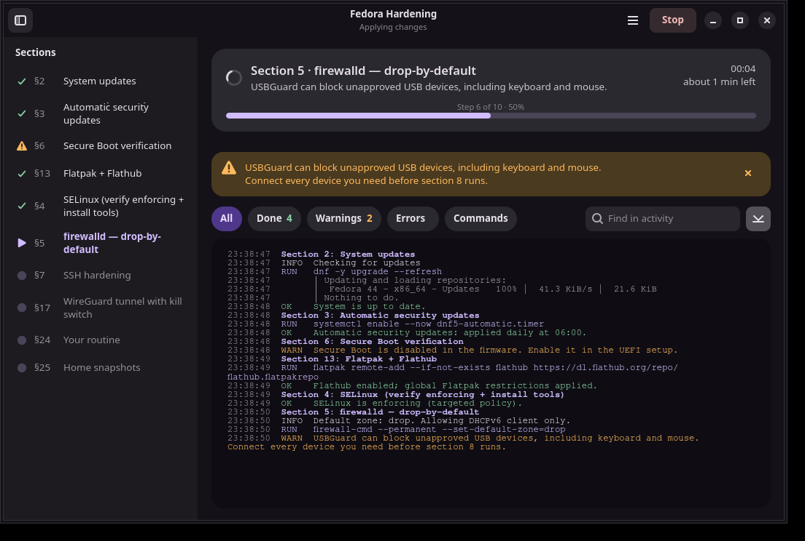
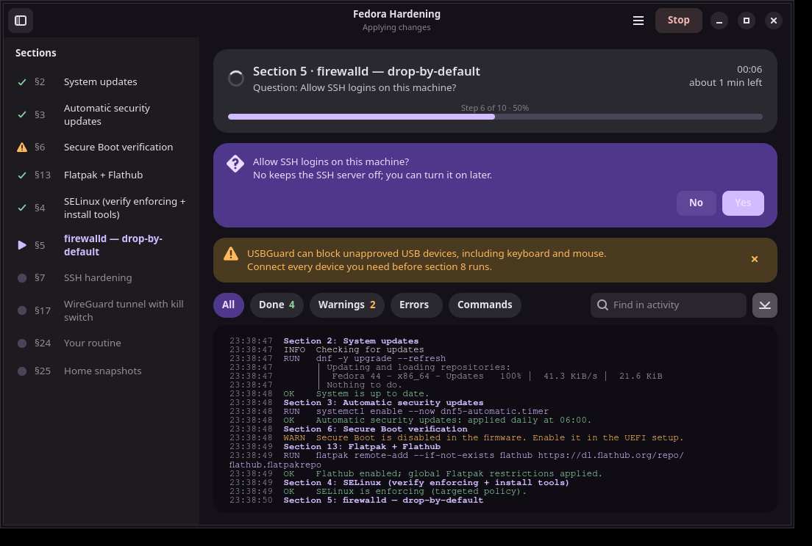
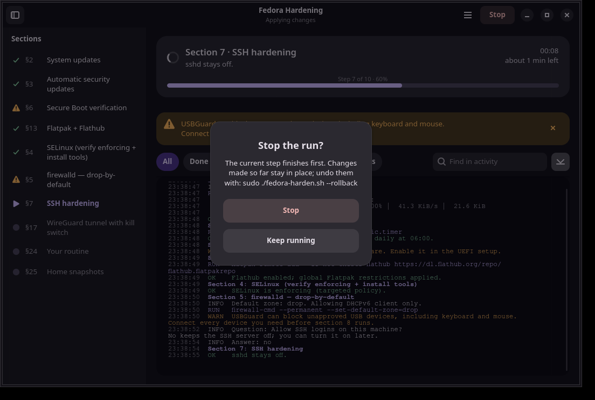
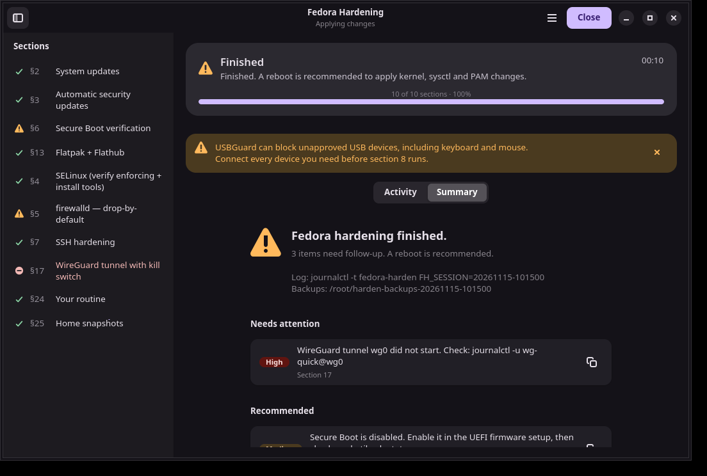

# fedora-harden guide

The parts of the script that need more than a line in the README.

## GUI

```bash
sudo ./fedora-harden.sh --gui          # the whole run in one window
```

Everything happens in one window:

- **Sections** (left): every section this run will go through, in execution order,
  with its status: running, done, done with warnings or errors, or skipped when it
  does not apply to this system. F9 shows or hides the list; narrow windows fold it
  away.
- **Status card**: the section running now and its latest step, a progress bar,
  the elapsed time and an estimate of the time left.
- **Questions** appear inside the window with Yes/No buttons or a text field. Enter
  picks the default answer; nothing pops up in a separate dialog.
- **Notices** that need reading (USBGuard, the manual GRUB password, VPN choices)
  stay at the top until you dismiss them.
- **Activity**: a live log of every message, command and command output, with
  filters (done, warnings, errors, commands), search, follow mode, and Copy activity
  log / Copy problems only in the menu.
- **Summary**: at the end, the outcome, the log and backup locations, and the
  follow-up items grouped by priority, each with a copy button.

**Stop** (or closing the window, or Ctrl+W) asks first, then stops after the
current step with exit code 130; changes made so far can be undone with
`--rollback`. The window stays open after the run so you can read the results.

The window is a GTK4/libadwaita app (`libexec/fedora-harden-gui.py`). Those libraries and their
Python bindings come with Fedora Workstation and every Atomic desktop (Silverblue,
Kinoite, Bazzite, Bluefin), so nothing is layered for the GUI; on other package-based
systems `--gui` installs `python3-gobject`, `gtk4` and `libadwaita`. Its Material
Design 3 dark theme is private to the window and does not change your desktop. It
works under `sudo` (Fedora keeps `DISPLAY`/`XAUTHORITY`). Without a usable display,
the run stays in the terminal.

| Running | Question |
|---|---|
|  |  |
| **Stopping** | **Summary** |
|  |  |

Screenshots are generated by `tests/gui-screenshots.sh`, which plays a sample run
into the window app (`libexec/fedora-harden-gui.py`; Fedora 44, virtual display, so the
rounded window corners a compositor draws on a real desktop are not shown).

## Platform Support

| Variant | Package Manager | Desktop |
|---------|----------------|---------|
| Fedora Workstation | `dnf` | GNOME |
| Fedora Server | `dnf` | — |
| Fedora Spins (XFCE, LXQt, Cinnamon, MATE, Budgie) | `dnf` | various |
| Fedora Silverblue | `rpm-ostree` | GNOME |
| Fedora Kinoite | `rpm-ostree` | KDE Plasma |
| Fedora Onyx | `rpm-ostree` | GNOME Atomic |
| Fedora Sericea | `rpm-ostree` | Sway Atomic |
| Fedora Lazurite | `rpm-ostree` | LXQt Atomic |
| Fedora Vauxite | `rpm-ostree` | XFCE Atomic |
| Fedora IoT / Cloud / CoreOS | `rpm-ostree` | headless |
| Bazzite | `rpm-ostree` | KDE or GNOME |
| Aurora / Universal Blue | `rpm-ostree` | KDE |

Auto-detection reads `/etc/os-release` + `/run/ostree-booted`. Desktop detection uses `$XDG_CURRENT_DESKTOP` + installed tooling.

## Image-based systems

On Silverblue, Kinoite, Bazzite, Aurora and the other Atomic variants, every
layered package has to be re-applied to each new image, and it widens the image
everyone else gets from the vendor. So the script keeps tools out of the image and
puts each one where it belongs:

| What | Package-based Fedora | Image-based Fedora |
|------|----------------------|--------------------|
| YubiKey manager (section 1) | `yubikey-manager`, `yubico-piv-tool` | Yubico Authenticator Flatpak (`com.yubico.yubioath`); only drivers and `pam-u2f` are layered |
| SELinux tools `seinfo`, `sesearch` (4) | `setools-console` | in the tools box |
| File integrity (24) | AIDE + weekly timer | image signature check + weekly report of `/etc` changes (`journalctl -t fedora-harden-etc`) |
| Metadata removal (13) | `mat2` | Metadata Cleaner Flatpak |
| ClamAV (21) | clamd, freshclam, on-access scanning | weekly `fedora-harden-clamscan` container: read-only view of `/home`, no network, signatures in the image |
| OpenSCAP (22) | `openscap-scanner` | throwaway Fedora container scanning the host read-only (`oscap-chroot`) |
| buildah, skopeo, podman-compose (23) | packages | in the tools box |

The **tools box** (`fedora-harden-tools`) uses the platform's own tool: distrobox
on Universal Blue (which ships it instead of toolbox), toolbox elsewhere. With
distrobox, the script writes a manifest to `~/.config/distrobox/fedora-harden-tools.ini`:

```bash
distrobox assemble create --file ~/.config/distrobox/fedora-harden-tools.ini
# Universal Blue:
ujust distrobox-assemble CONTAINER=fedora-harden-tools FILE=$HOME/.config/distrobox/fedora-harden-tools.ini
```

> ⚠️ **Toolbox and distrobox are not a security boundary.** Their containers share
> your home directory, see the host's filesystem at `/run/host` and run privileged
> without SELinux separation. Use them to keep the host clean, not to run untrusted
> software — for that, use a Flatpak with tight permissions or a locked-down
> `podman run --read-only --cap-drop all --network none ...`.

## Your routine (Section 19)

Hardening is not a one-time job: updates, cleanup, disk health, and noticing when a
protection was undone. Section 19 sets that up to match how the machine is used. It
detects the likely use cases (Steam or Bazzite: gaming; Blender, Kdenlive, Resolve:
creative; IDEs or container storage: development; a battery: laptop), asks once
(or takes `--profile`), saves the answer in `/etc/fedora-harden/profile`, and adds only
the timers those use cases need:

| Timer | What it does | For |
|-------|--------------|-----|
| `fedora-harden-cleanup` (monthly) | unused Flatpak runtimes, dangling Podman images, old OSTree data | everyone |
| `fedora-harden-diskspace` (daily) | notifies below 10% free | everyone |
| `fedora-harden-scrub` (monthly) | Btrfs scrub: finds silent corruption | Btrfs systems |
| `fedora-harden-drift` (weekly) | notifies if a file the script manages changed or a service it started stopped | everyone |
| `fedora-harden-summary` (Mondays) | what was done, what needs you, open follow-ups; a relevance review every 90 days | everyone |
| `fedora-harden-boxes` (weekly) | upgrades toolbox/distrobox containers (Universal Blue's uupd already does) | creative, dev |
| `fedora-harden-devclean` (weekly) | removes container build cache older than 30 days | dev |
| `fedora-harden-flatpak-perms` (weekly, asked) | tells you when an app update widened its permissions | creative |

Plus a 1 GB journal cap, `smartd` disk-health warnings, an optional 80% battery
charge limit on laptops, and on image-based systems a list of layered packages that
have a better home. Heavy jobs wait for mains power and for a game to end. A desktop
notification appears only when something needs you; the weekly summary is in
`/var/lib/fedora-harden/summary-<date>.txt`, and every run is in
`journalctl -t fedora-harden-routine`. Every 90 days the summary asks for a review: if
the machine now looks different from its saved use cases, or an automation has had
no effect, it says so. Re-run `--only 19` to change the routine; `--rollback` removes it.

### Personal setup

Section 19 also offers, once each, what fits the use cases. Each is a question; with
`--yes` only the ones a chosen use case implies happen. `--rollback` undoes all of them.

| Offer | What happens | When |
|-------|--------------|------|
| `dev` box | a toolbox/distrobox with gcc, make, cmake, git and Python, created for you in the background; on distrobox the build tools also work from the host's terminal | dev |
| `davincibox` | the container the davincibox project provides for DaVinci Resolve (the NVIDIA or OpenCL build), plus the `render`/`video` groups; you add the Resolve installer you downloaded, and Resolve appears in the app menu (Bazzite: `ujust install-resolve` instead) | creative |
| Tor Browser and Mullvad Browser | from Flathub; only Tor Browser hides who you are | `private` use case |
| Verified Flathub apps only | Flathub shows apps published by their own developers | asked |
| Security key for sudo and login | registers your key, then makes it a second factor (pam-u2f via authselect); keep a second key registered | asked, when section 1 installed key support |
| Disk unlock with TPM + PIN or FIDO2 | only when the root disk is already encrypted; the passphrase keeps working | asked |
| OpenSnitch | Fedora does not package it, so the script only points you to its signed RPMs | asked |

Nothing is layered on image-based systems.

### Recovery file

After every run, `/etc/fedora-harden/machine.conf` records what this machine was set
up with: Fedora release and edition, the sections run, use cases, boxes, Flatpaks the
script installed, enabled timers, the snapshot setup, the choices above and the
answer to every question. It is readable by root only and holds no secrets (for the
WireGuard tunnel it notes where the config was, not the config). It is also copied
into the home folder's backups (`/home/.fedora-harden/`), so it survives a reinstall;
`--recovery-backup off` stops that (remembered).

After a reinstall or a recovery:

```bash
sudo ./fedora-harden.sh --restore machine.conf     # same sections, same answers, no questions
```

`--report` says when the recovery file was last updated but leaves its contents out,
so the page can be shared; `--report --include-setup` adds them.

## Home snapshots (Section 20)

Gets back a file you deleted or overwrote, on every supported system, with what the
system already ships:

| System | How |
|--------|-----|
| Btrfs with Snapper (Bazzite) | Snapper's own `home` config |
| Btrfs without Snapper (Silverblue, Kinoite, Bluefin, Aurora, Workstation) | read-only Btrfs snapshots in `/home/.snapshots` |
| Btrfs where home is a plain folder (bootc installs) | home becomes its own subvolume at the next boot, before anyone logs in; snapshots start then |
| No Btrfs (e.g. Fedora Server on XFS) | hard-link incremental copies with `rsync`: to a second drive when configured (`--backup-target DIR`, `/backup`, `/mnt/backup`), otherwise on the same disk |

- **As often as the machine is used:** 6+ active hours a day → hourly, 1–6 → every
  6 hours, less → daily; nothing is taken when nothing changed. Kept: 24 recent,
  7 daily, 4 weekly. Snapshots never push the disk below 15% free.
- **Index and change notes:** the first run indexes the home folder (folders of
  5 GB or more); each snapshot keeps a note of what changed; the weekly index notes
  what grew and flags new large folders. Large replaceable folders (container
  storage, caches, game libraries) are left out of snapshots only if you say yes,
  folder by folder.
- **Not a backup:** snapshots live on the same disk. The follow-ups rank ways to
  keep a copy elsewhere for this machine (an external drive with Pika Backup, a
  network share, or cloud storage with Déjà Dup); the choice is yours.
- **Restore** by copying from `/home/.snapshots/<date>/<user>/…` (or Snapper's
  tools on Bazzite). `--rollback` removes the timers but never deletes snapshots.

## WireGuard with a kill switch (Section 15)

Download a WireGuard config from your VPN provider (a full tunnel:
`AllowedIPs = 0.0.0.0/0, ::/0`) and pass it to section 15:

```bash
sudo ./fedora-harden.sh --only 15 --wireguard-config ~/Downloads/provider.conf
```

The script checks the config (complete, one peer, full tunnel; a hostname endpoint
is pinned to its current address), installs it as `/etc/wireguard/wg0.conf`
(mode 600) and starts `wg-quick@wg0` at boot. Two protections come with it:

- **Kill switch** — firewalld policies let this machine send traffic only into the
  tunnel or to the tunnel's own endpoint. If the tunnel drops, nothing leaks out
  around it (the local network is blocked too; the follow-up says how to allow it).
- **DNS through the tunnel** — systemd-resolved sends every lookup to the tunnel's
  DNS server while it is up.

`--rollback` stops the tunnel and removes the config and the kill switch. Without a
config file, section 15 does nothing.

## Hardware Security Keys

During **Section 1**, the script will ask if you use a hardware security key (YubiKey, FIDO2, PIV, etc.). If yes, it installs `pcsc-lite`, `opensc`, `libfido2`, `yubico-piv-tool`, and `yubikey-manager`, and optionally sets up `pam-u2f`. On image-based systems it layers only the drivers (and `pam-u2f`) and installs the Yubico Authenticator Flatpak instead of the management tools.

> ⚠️ **Important:** If you use a hardware key, plug it in **before Section 23 (USBGuard) runs** so it is automatically added to the allowlist. If you miss it, run:
> ```bash
> sudo usbguard generate-policy >> /etc/usbguard/rules.conf
> ```

## Container Security (Section 18)

Section 18 sets up a **containerized-mindset** environment using rootless Podman and toolbox (distrobox on Universal Blue):

- Configures `~/.config/containers/containers.conf` with `no-new-privileges`, hardened seccomp, and minimal capabilities
- Writes `/etc/containers/policy.json` to reject images from registries other than Fedora, CentOS, Red Hat, quay.io and docker.io (confirm-gated)
- Blocks unqualified image searches via `/etc/containers/registries.conf.d/99-hardening.conf`
- Configures `subuid`/`subgid` for rootless container operation
- Optionally installs `buildah`, `skopeo`, and `podman-compose` — on image-based systems they go in the tools box instead (see [Image-based systems](#image-based-systems))

Toolbox and distrobox keep development tools off the host; they do not isolate them (see the warning above).

## Scorecard and deeper hardening

**Protection scorecard.** At the end of every run, on the `--gui` summary page, in
`--report` and with `--score`, the script checks the live system, not what the run
did: disk encryption, Secure Boot, firewall, automatic updates, SELinux, the SSH
server, DNS over TLS, home snapshots, screen lock, Flatpak restrictions, the
firmware security level (fwupd HSI) and, as advice, whether the everyday account is
an administrator. Each line that is not protected says how to fix it. `--score`
changes nothing and creates no session.

**Kernel boot hardening (opt-in).** Section 9 can add `init_on_free=1`,
`slab_nomerge`, `page_alloc.shuffle=1` and `randomize_kstack_offset=on` to the
kernel command line (grubby, or `rpm-ostree kargs` on image-based systems). They make
memory bugs harder to exploit and cost about 1–5% in some workloads, so they are
asked for, never added by `--yes` alone (use `--kernel-hardening`), and not offered
for the gaming use case. `--rollback` removes exactly the options it added.

**Service sandboxing.** Section 21 gives running network services (CUPS, Avahi) a
drop-in with conservative systemd sandboxing, keeps it only if the service restarts
cleanly, and reports the `systemd-analyze security` exposure before and after.
sshd is left alone: its sandbox would also restrict every SSH login session.

